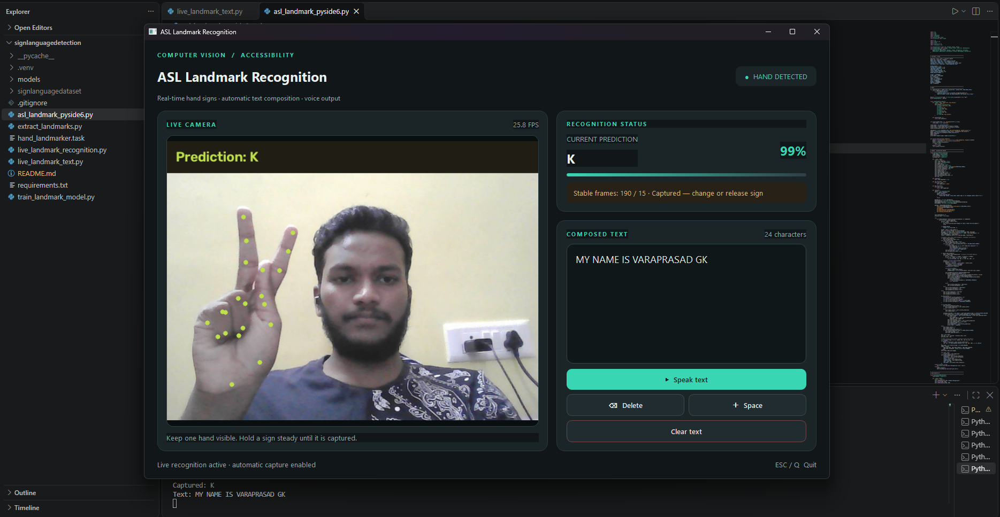

# 🤟 ASL Landmark Recognition

### Real-Time Hand Gesture Recognition with Python, MediaPipe & PyTorch

A real-time American Sign Language (ASL) alphabet recognition application that uses hand landmarks and machine learning to recognize gestures, compose text automatically, and convert the composed text into speech.

Built with **Python, MediaPipe, PyTorch, OpenCV, and PySide6**, this project combines computer vision and a desktop interface to explore accessible, gesture-based interaction.

<p align="center">
  
</p>

<p align="center">
  <strong>Real-Time Recognition · Automatic Text Composition · Text-to-Speech</strong>
</p>

---

## ✨ Features

- **Real-time hand tracking** — Detects hand landmarks from a webcam using MediaPipe.
- **Landmark-based classification** — Predicts gestures using a trained PyTorch Multi-Layer Perceptron (MLP).
- **Interactive desktop UI** — A dark charcoal interface with teal accents, built using PySide6.
- **Automatic letter capture** — Captures stable alphabet predictions without requiring a button press for every letter.
- **Automatic spacing** — Inserts a space after a configurable period without a detected hand when composing a word.
- **Text composition and editing** — Add spaces, delete characters, clear the text, and select or copy composed text.
- **Text-to-speech** — Read the composed text aloud using the `V` shortcut.
- **Prediction stabilization** — Uses temporal smoothing and confidence checks to reduce unstable predictions.

## 🛠️ Technology Stack

| Technology | Role |
|---|---|
| Python | Core application logic |
| MediaPipe | Hand detection and landmark extraction |
| PyTorch | Gesture classification |
| OpenCV | Webcam capture and image processing |
| NumPy | Numerical computation and feature processing |
| PySide6 | Desktop user interface |
| pyttsx3 | Text-to-speech output |

## 🧠 How It Works

The application uses a two-stage computer vision pipeline: hand landmark detection followed by gesture classification.

1. **Capture:** OpenCV reads frames from the webcam.
2. **Detect:** MediaPipe identifies the hand and its 21 landmarks.
3. **Extract features:** The landmark coordinates are normalized and transformed into a 63-feature representation.
4. **Classify:** A trained MLP predicts the gesture class.
5. **Stabilize:** Prediction smoothing and confidence checks help prevent unstable classifications from being captured.
6. **Compose text:** Stable letter predictions are appended automatically, and a no-hand timeout can insert spaces.
7. **Speak:** The user can trigger text-to-speech for the composed text.

## 🔤 Recognition Classes

The trained classifier supports 29 classes:

- **Alphabet:** `A`–`Z`
- **Special classes:** `space`, `del`, and `nothing`

The application uses its text-composition logic to determine how predictions are handled. The current project focuses on alphabet-level recognition and does not perform full ASL sentence translation.


## 🚀 Getting Started

### Prerequisites

- Windows 10/11 or another compatible desktop environment
- Python 3.12 recommended for the current development setup
- A working webcam
- The required trained model files and MediaPipe task asset

### 1. Clone the repository

```bash
git clone https://github.com/varaprasad4959/asl-landmark-recognition.git
cd asl-landmark-recognition
```

To use the latest desktop UI before it is merged into `main`:

```bash
git checkout feature/automatic-letter-capture
```

### 2. Create a virtual environment

On Windows PowerShell:

```powershell
python -m venv .venv
.\.venv\Scripts\Activate.ps1
```

### 3. Install dependencies

```powershell
python -m pip install --upgrade pip
python -m pip install opencv-python numpy torch mediapipe pyttsx3 PySide6
```

> These commands install the main runtime dependencies. Depending on your Python and operating system versions, PyTorch installation may require a platform-specific command from the official PyTorch installation guide.

### 4. Verify the required assets

The PySide6 application expects the following files:

```text
hand_landmarker.task
models/
├── asl_landmark_mlp.pth
├── asl_landmark_scaler.npz
└── asl_land